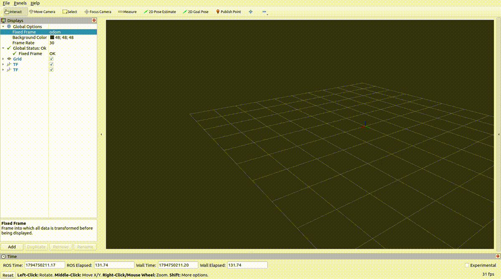
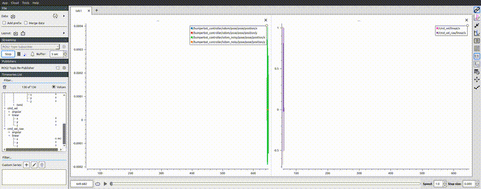

# ROS2-Gazebo: Навигация робота в снегу/на льду

## О проекте

Проект моделирует поведение мобильного робота на скользкой поверхности (снег, лёд), где возникает  
расхождение между показаниями одометрии и реальным положением робота.  

На текущем этапе реализованы **описание робота**, **интеграция с Gazebo Classic**, **контроллер
дифференциального привода с двумя режимами одометрии** (честная и шумная), а также узел-возмутитель,
который искажает команды скорости перед отправкой в симулятор. Демо-мир и SLAM ещё не реализованы, - см. раздел TODO.

## Демонстрации

**RViz: расхождение одометрий.** Видно, как расходятся TF-ветки.
Одна это честная одометрия из simple_controller, вторая это шумная
из noisy_controller. Робот физически один, но система видит два разных
положения. Именно ради этого затевался проект: на скользкой поверхности
энкодеры не знают о проскальзывании, и оценка положения уходит от реальности.



**PlotJuggler: возмущения в командах скорости.** Графики /cmd_vel и /cmd_vel_raw.
Узел-возмутитель добавляет шум, продольное проскальзывание, боковой снос и кочки.
Видно, как ровная команда от телеопа превращается в то, что получает Gazebo.
Робот виляет и сносит, хотя команда прямая.



## Стек

- Ubuntu 22.04
- ROS 2 Humble
- Gazebo Classic (Gazebo 11)

## Структура репозитория (на текущий момент)
```bash
    src/
    ├── bumperbot_description/
    │   ├── CMakeLists.txt
    │   ├── package.xml
    │   ├── launch/
    │   │   ├── display.launch.py
    │   │   └── gazebo.launch.py
    │   ├── meshes/
    │   ├── rviz/
    │   │   └── display.rviz
    │   └── urdf/
    │       ├── bumperbot.urdf.xacro
    │       └── bumperbot_gazebo.xacro
    └── bumperbot_controller/
        ├── CMakeLists.txt
        ├── package.xml
        ├── config/
        │   ├── joy_config.yaml
        │   ├── joy_teleop.yaml
        │   └── perturbation_params.yaml
        ├── include/bumperbot_controller/
        │   ├── simple_controller.hpp
        │   ├── noisy_controller.hpp
        │   └── perturbation_node.hpp
        ├── launch/
        │   ├── controller.launch.py
        │   └── joystick_teleop.launch.py
        └── src/
            ├── simple_controller.cpp
            ├── noisy_controller.cpp
            └── perturbation_node.cpp
```

## Что сделано

### 1. Описание робота (`bumperbot_description`)

- Дифференциальный привод: два ведущих колеса и две пассивные опоры.
- `base_footprint` как точка отсчёта одометрии, `base_link` как корпус, IMU на корпусе.
- Инерциальные параметры заданы для каждого звена.
- Коллизии колёс заданы сферами - осознанный компромисс для упрощения контактной задачи
  в Gazebo Classic (см. раздел «Известные ограничения»).

### 2. Интеграция с Gazebo Classic (`bumperbot_description`)

- **Дифференциальный привод**: плагин `libgazebo_ros_diff_drive.so`.
  Подписан на `/cmd_vel_raw`. Публикация одометрии и TF **отключена** -
  одометрию считает отдельный узел контроллера (см. ниже). Это позволяет
  независимо управлять тем, какую одометрию видит остальная система.
- **Публикация состояний суставов**: плагин `libgazebo_ros_joint_state_publisher.so`
  публикует `/joint_states` для обоих ведущих колёс с частотой 30 Гц.
- **IMU**: плагин `libgazebo_ros_imu_sensor.so` публикует `/imu/out`
  с гауссовым шумом на угловые скорости и линейные ускорения.
- Параметры трения колёс настроены для «сухой» поверхности (`mu1=mu2=10.0`) -
  базовая точка для дальнейшей имитации снега/льда.

### 3. Контроллер (`bumperbot_controller`)

Пакет содержит три независимых узла, которые можно включать и выключать
через аргументы launch-файла.

#### `simple_controller` - «честная» одометрия

- Подписан на `/cmd_vel_teleop` (тип `TwistStamped`, источник - джойстик или телеоп).
- Публикует команды в топик, задаваемый параметром `output_topic`
  (по умолчанию `/cmd_vel_raw` - напрямую в Gazebo).
- Считает одометрию из `/joint_states` методом интегрирования приращений колёс.
- Публикует `/bumperbot_controller/odom` (`nav_msgs/msg/Odometry`) и TF `odom → base_footprint`.

#### `noisy_controller` - «шумная» одометрия

- Подписан на тот же `/joint_states`.
- Добавляет **систематические ошибки** (завышенный радиус колеса, завышенная колея)
  и **гауссов шум на показания энкодеров** (`encoder_noise_std`).
- Публикует `/bumperbot_controller/odom_noisy` и TF `odom → base_footprint_noisy`.
- Использует отдельное TF-дерево (`base_footprint_noisy`), чтобы обе одометрии
  можно было визуализировать одновременно в RViz.

#### `perturbation_node`: узел-возмутитель

- Подписан на `/cmd_vel`, публикует в `/cmd_vel_raw`.
- Вклинивается между simple_controller и Gazebo и искажает команды скорости.
- Имеет главный переключатель enabled. Когда он выключен, команды проходят без изменений.
- Реализованные механизмы возмущения (каждый с отдельным параметром):
  - Гауссов шум на линейную и угловую скорость (`linear_noise_std`, `angular_noise_std`).
  - Продольное проскальзывание (`slip_ratio`, `slip_threshold`). Мультипликативное затухание
    линейной скорости, имитирует пробуксовку на снегу и льду.
  - Боковой снос через угловое возмущение (`lateral_slip_gain`, `lateral_slip_frequency`).
    Синусоидальный дрейф, амплитуда которого пропорциональна текущей линейной скорости.
    Имитирует виляние на скользкой поверхности.
  - Кочки (`bump_rate`, `bump_duration`, `bump_magnitude`). Пуассоновский процесс с импульсными
    возмущениями, имитирует редкие неровности.

**Зачем три узла?** Это позволяет независимо управлять тем, что видит система
и как движется робот. `simple_controller` даёт эталонную одометрию. `noisy_controller`
показывает, как ошибки энкодеров искажают оценку положения без изменения физики.
`perturbation_node` искажает саму физику движения. Комбинируя их, можно воспроизвести
разные сценарии: от идеальных условий до полностью разваливающейся одометрии.

### 4. Launch-файлы

- `controller.launch.py` - запуск контроллеров с аргументами:
  - `use_simple_controller` (по умолчанию `True`)
  - `use_noisy_controller` (по умолчанию `True`)
  - `wheel_radius`, `wheel_separation` - геометрия робота
  - `wheel_radius_error`, `wheel_separation_error` - систематические ошибки
  - `encoder_noise_std` - шум энкодеров
- `joystick_teleop.launch.py` - запуск `joy` и `joy_teleop` для управления с джойстика
  (публикует `/cmd_vel_teleop`).

## Как запустить

1. Соберите workspace:
```bash
       colcon build
       source install/setup.bash
```

2. Запустить Gazebo Classic со спавном робота:
```bash
       ros2 launch bumperbot_description gazebo.launch.py
```

3. В отдельном терминале запустить контроллеры:
```bash
       ros2 launch bumperbot_controller controller.launch.py
```

4. Управлять роботом:
```bash
       # напрямую через топик
       ros2 topic pub /cmd_vel_teleop geometry_msgs/msg/TwistStamped \
         "{header: {frame_id: base_link}, twist: {linear: {x: 0.2}}}"

       # или с джойстика
       ros2 launch bumperbot_controller joystick_teleop.launch.py
```

5. Сравнить одометрии:
```bash
       ros2 topic echo /bumperbot_controller/odom --field pose.pose.position
       ros2 topic echo /bumperbot_controller/odom_noisy --field pose.pose.position
```

6. Запустить узел-возмутитель (физическое виляние):
```bash
ros2 launch bumperbot_controller controller.launch.py use_perturbation:=True
```

## Режимы работы

| Режим | use_simple_controller | use_noisy_controller | use_perturbation |
|---|---|---|---|
| Чистая одометрия | True | False | False |
| Шумная одометрия | True | True | False |
| Только возмутитель | True | False | True |
| Возмутитель и шумная одометрия | True | True | True |

## Известные ограничения

- **Коллизии колёс - сферы, а не цилиндры.** Приводит к небольшому «рысканию»
  при прямолинейном движении из-за численных погрешностей контактного решателя.
  Для задачи имитации скользкой поверхности это допустимо.
- **Gazebo Classic официально EOL с января 2025.** Проект сознательно остаётся на нём
  из-за привязки к ROS 2 Humble и Ubuntu 22.04. Переход на Gazebo Sim (Ignition)
  запланирован как отдельная задача после завершения основного функционала.
- **`noisy_controller` искажает только одометрию, но не физику.** Робот в Gazebo
  движется одинаково при любом значении `encoder_noise_std`.
- perturbation_node искажает только команды скорости. Он не моделирует
  боковое проскальзывание на уровне контакта колёс с поверхностью.
  Это упрощение, достаточное для демонстрации расхождения между
  физическим и оценённым положением.

## TODO

- [ ] Демо-мир в Gazebo Classic (склад).
- [ ] SLAM (Graph SLAM / SLAM Toolbox) в условиях шумной одометрии.
- [ ] Визуализация обеих одометрий в RViz (конфиг display.rviz для режима сравнения).
- [ ] Переход на Gazebo Sim (Ignition). Отдельная задача, после стабилизации основного функционала.
- [ ] Настройка джойстика для плавного управления (мертвая зона, масштабирование осей).

## Disclaimer
- Описание робота и конфигурация симуляции в этом проекте основаны на учебных материалах  
Antonio Brandi (лицензия Apache 2.0).

- Оригинальные авторские права принадлежат Antonio Brandi. Контактное лицо для данного  
репозитория: Глеб Бабенко (babenkogleb@gmail.com).

Изменения относительно оригинальных материалов: 
- адаптация плагинов под Gazebo Classic,  
- отключение публикации одометрии из плагина diff_drive, переименование топика команд  
- в /cmd_vel_raw, добавление параметра `output_topic` в `simple_controller`, настройка параметров трения.  
- добавление узла-возмутителя с механизмами шума, проскальзывания, бокового сноса и кочек.
